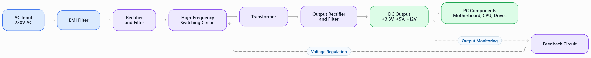

# Q1.List 3 real-world devices in your home or college that use SMPS (Switched Mode Power Supply) and 2 devices that use UPS (Uninterruptible Power Supply), explaining in one line why each device needs that type of power supply.
Ans>
## ⚡ Real-World Applications of SMPS and UPS

### 1. Devices That Use SMPS (Switched Mode Power Supply)

| No. | Device | Why It Uses SMPS |
|---|---|---|
| 1 | Desktop Computer | Converts AC power into regulated DC power for computer components. |
| 2 | Laptop Charger | Converts AC electricity into suitable DC power to charge the laptop battery. |
| 3 | LED Television | Provides efficient, regulated DC power to the TV's electronic circuits. |

### 2. Devices That Use UPS (Uninterruptible Power Supply)

| No. | Device | Why It Uses UPS |
|---|---|---|
| 1 | Desktop Computer | Provides temporary backup power during a power cut, allowing safe shutdown. |
| 2 | Wi-Fi Router | Keeps the internet connection running temporarily during a power outage. |

### ✅ Conclusion

SMPS provides efficient and regulated power to electronic devices, while a UPS supplies temporary backup power during electrical interruptions.
# Q2.Draw and label a diagram showing the main internal components of a typical SMPS unit found in a desktop PC, including AC input, rectifier, transformer, and DC output sections.  <em><strong>Hint:</strong> You can hand-draw and upload a photo, or use any free diagram tool like draw.io.</em>
Ans>
 >Working: AC input ko rectify karke high-frequency switching circuit aur transformer ke through convert kiya jata hai. Output rectifier aur filter stable DC voltages dete hain jo computer components ko power dete hain.
 >Note: SMPS ke andar dangerous high voltage ho sakta hai, power unplug hone ke baad bhi. Isse kholne se bachein.
# Q3.Take photos or find clear images online of the following power connectors: ATX 24-pin motherboard connector, SATA power connector, Molex connector, and PCIe 6/8-pin connector. For each, write its name, the devices it powers, and one safety tip for connecting/disconnecting it.
Ans>
# 🔌 Desktop PC Power Connectors

## 1. ATX 24-Pin Motherboard Connector

- **Name:** ATX 24-Pin Motherboard Power Connector
- **Devices Powered:** Supplies power to the motherboard and its circuits.
- **Safety Tip:** Switch off and unplug the PSU before connecting or disconnecting the cable. Ensure the locking clip is securely engaged.

## 2. SATA Power Connector

- **Name:** SATA Power Connector
- **Devices Powered:** SATA hard drives, SSDs, and optical drives.
- **Safety Tip:** Align the L-shaped connector correctly and never force it into the socket.

## 3. Molex 4-Pin Connector

- **Name:** Molex 4-Pin Peripheral Power Connector
- **Devices Powered:** Older hard drives, optical drives, and some case fans.
- **Safety Tip:** Disconnect power before removal and pull the connector by its plastic housing, not by the wires.

## 4. PCIe 6/8-Pin Connector

- **Name:** PCIe 6-Pin / 8-Pin Graphics Card Power Connector
- **Devices Powered:** Graphics cards (GPUs) that require additional power.
- **Safety Tip:** Use the correct PCIe cable, ensure it is fully inserted, and never confuse it with the CPU/EPS power connector.

## ✅ General Safety Precautions

1. Turn off the computer and unplug it before handling internal power cables.
2. Never force a connector into a socket.
3. For modular PSUs, use only cables approved for that exact PSU model.
4. Never open the PSU casing because its capacitors can retain dangerous voltage.
# Q4.Imagine you are setting up a new gaming PC. List the steps you would follow to connect the SMPS to the motherboard, graphics card, and storage devices, mentioning which specific cables and connectors are used for each.
Ans.
# 🎮 Connecting an SMPS in a Gaming PC

## Step-by-Step Procedure

### 1. Safety Precautions
- Switch off the SMPS and unplug it from the wall socket.
- Place the PC components on a clean, non-conductive surface.
- Use only cables compatible with the specific SMPS model.

### 2. Connect the Motherboard
- Locate the **24-pin ATX power cable** from the SMPS.
- Align it with the 24-pin motherboard power socket.
- Push it gently until the locking clip clicks into place.
- Connect the **4-pin or 8-pin CPU/EPS power cable** to the motherboard's CPU power socket near the processor.

### 3. Connect the Graphics Card (GPU)
- Identify the GPU's required power connector: **PCIe 6-pin, 8-pin (6+2), or 12V-2x6**, depending on the graphics card.
- Connect the appropriate cable from the SMPS to the GPU.
- Ensure the connector is fully inserted and securely fitted.
- Never force the connector or substitute a CPU/EPS cable for a PCIe cable.

### 4. Connect Storage Devices
- For a SATA SSD or HDD, connect a **15-pin SATA power cable** from the SMPS.
- Connect a **SATA data cable** from the drive to the motherboard.
- For an M.2 NVMe SSD, install it in the motherboard's M.2 slot; it generally does not require a separate power cable.

### 5. Connect Other Components
- Connect compatible case fans or accessories to the appropriate power connectors, if required.
- Keep cables organized to improve airflow and prevent interference with fans.

### 6. Final Inspection and Startup
- Check that all power connectors are fully seated.
- Verify that no cables obstruct the cooling fans.
- Close the PC case, connect the power cord, and switch on the SMPS.
- Start the computer and confirm that the system boots correctly.

## 🔌 Summary of SMPS Connectors

| Component | Cable / Connector | Purpose |
|---|---|---|
| Motherboard | 24-pin ATX | Main motherboard power |
| CPU | 4-pin / 8-pin EPS | Supplies power to the CPU voltage-regulation circuitry |
| Graphics Card | PCIe 6-pin / 8-pin or 12V-2x6 | Supplies additional GPU power |
| SATA SSD / HDD | 15-pin SATA power | Supplies power to storage devices |
| SATA SSD / HDD | SATA data cable | Transfers data between the drive and motherboard |

## ✅ Conclusion

The SMPS distributes regulated power to the motherboard, CPU, graphics card, and storage devices through their specific connectors. Correct cable selection and secure connections help ensure safe and reliable operation of a gaming PC.

**Safety Note:** Never open the SMPS casing, and never reuse modular PSU cables unless they are confirmed compatible with the exact PSU model.
